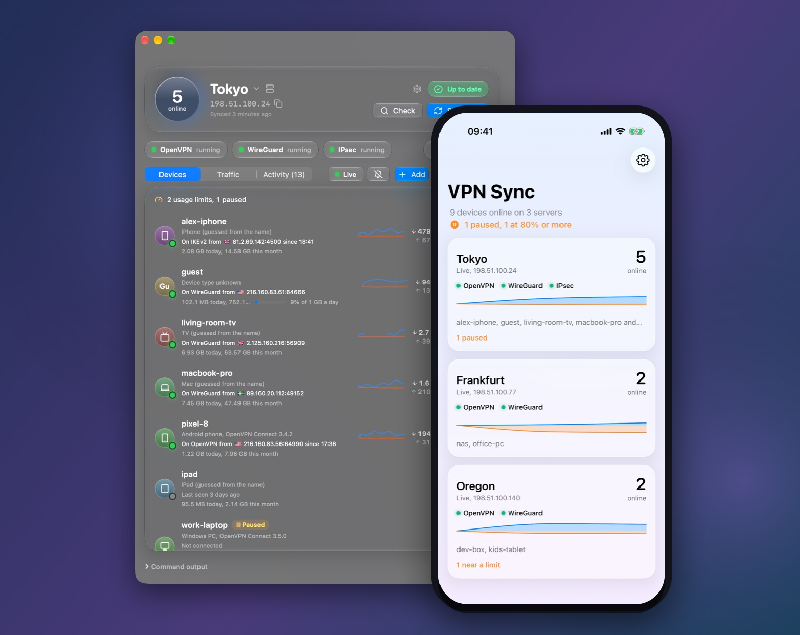
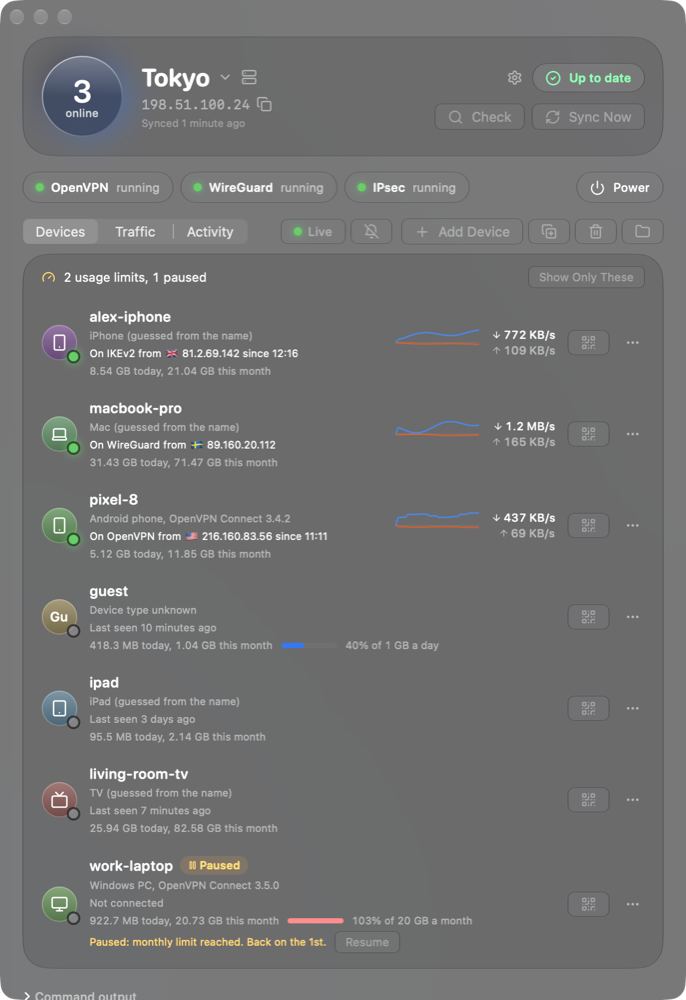
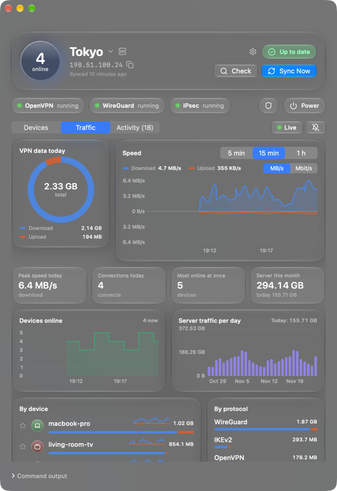
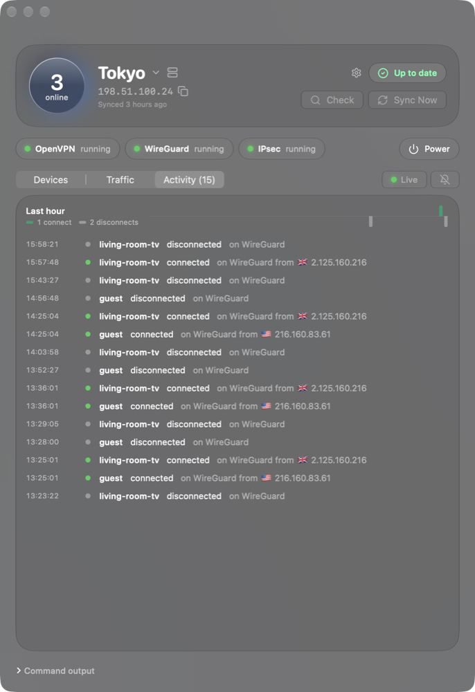
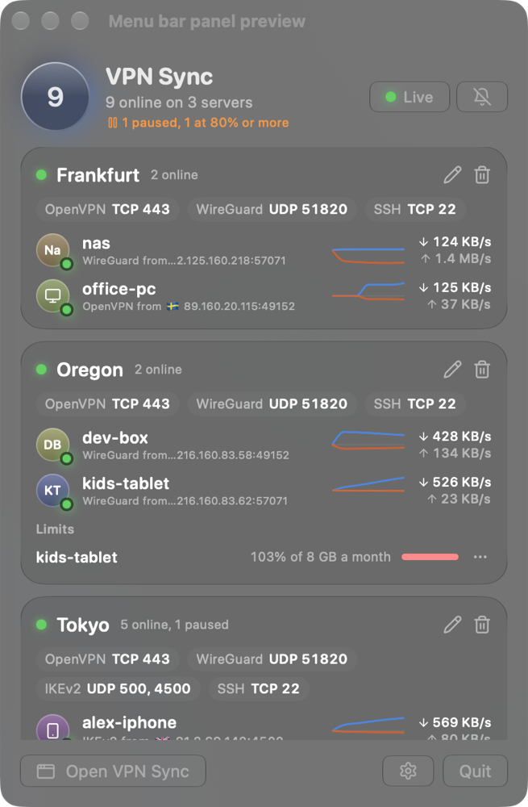
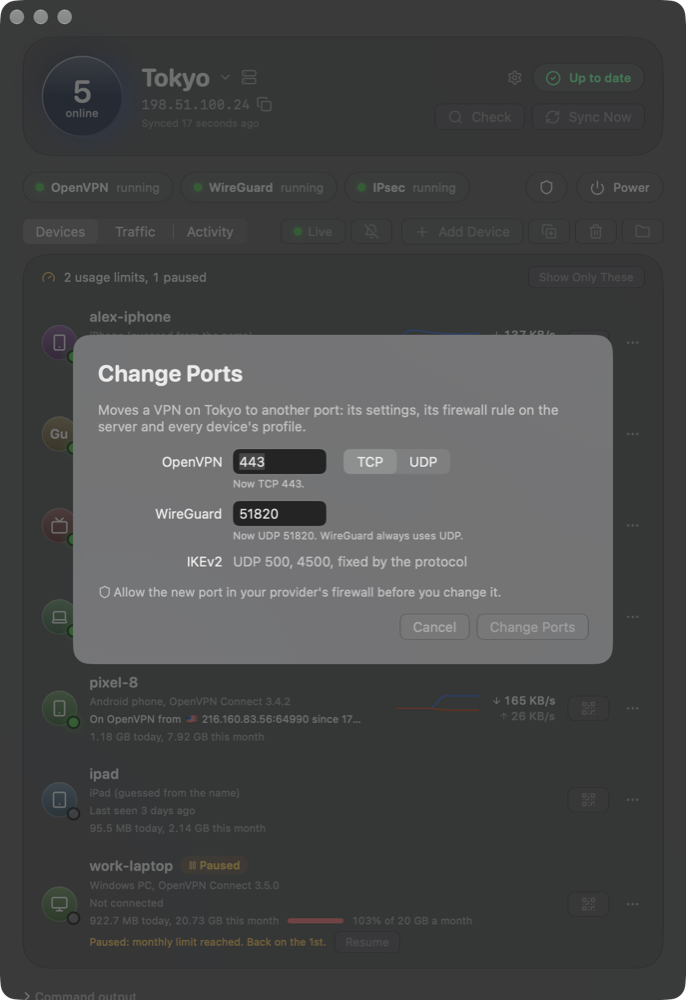
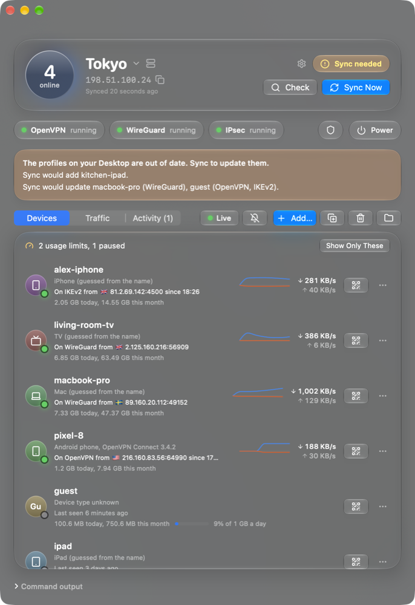
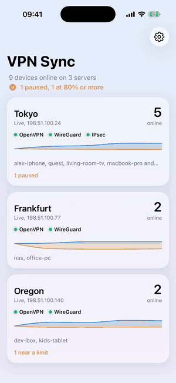
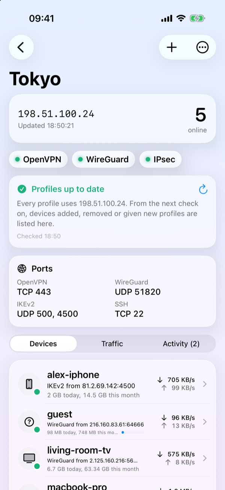
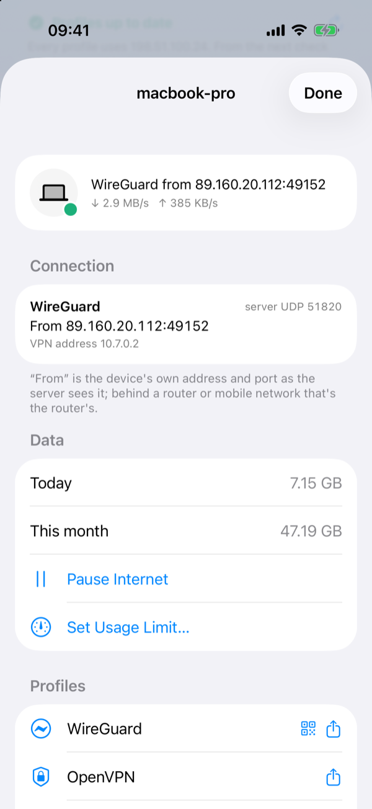

English | [简体中文](README.zh-CN.md)

<p align="center">
  
</p>

<h1 align="center">VPN Sync</h1>

<p align="center">
  <b>See and control your own VPN servers from your Mac and iPhone.</b><br>
  Install OpenVPN, WireGuard and IKEv2, or adopt the server you already set up with a script,<br>
  then watch who's connected, set limits, and manage every device's profiles in one place.
</p>

<p align="center">
  
</p>

## Why

One-command installers like [Nyr's openvpn-install and wireguard-install](https://github.com/Nyr)
and [hwdsl2's setup-ipsec-vpn](https://github.com/hwdsl2/setup-ipsec-vpn) get a VPN running in
minutes. After that the script is the whole interface: you can't see who's connected or how much
data each device uses, adding a device means SSH and a text menu, profiles end up scattered, a
new IP address breaks every client, and a second server doubles all of it.

VPN Sync sits on top of those scripts. It keeps your existing installs as they are, adds a small
set of tools on each server, and gives you one place to see and manage every server and device.
It can also set up a fresh server for you.

## What you get

| | |
|---|---|
| **Every server in one place** | Switch between servers, or see all of them at once in the menu bar. Servers behind a firewall are reached through another server over a private network. |
| **Live view** | Who's connected right now, on which VPN, from which country and port, since when and how fast, with a log of connects and disconnects and a notification for each. |
| **Ports** | The ports each server listens on (OpenVPN, WireGuard, IKEv2, SSH) and the address and port each connected device comes from. Move OpenVPN or WireGuard to another port: the server, its firewall rule, every profile and, on Lightsail, the cloud firewall are changed together. |
| **Traffic** | Speed over time, data per device and per protocol, the server's traffic per day for a month. |
| **Usage limits** | A daily or monthly limit per device that alerts you at 80% and 100%, or also pauses it. Pause or resume any device's internet by hand; it stays connected and nothing is revoked. |
| **Devices and profiles** | Add, batch add, remove and batch remove devices on every VPN at once. WireGuard QR codes for phones and TVs, IKEv2 profiles that install natively on iPhone, Mac, Android and Windows. **Check** compares the server's profiles with your copies and lists what a sync would add, remove or update. |
| **IP changes handled** | Each server rewrites its own profiles when its address changes; the Mac pulls fresh copies, fixes OpenVPN Connect and, with a Lightsail key, finds a stopped-and-started server's new IP on its own. |
| **Start and stop servers** | Stop a Lightsail server you don't need and start it again from the Mac, the menu bar or the iPhone; VPN Sync shows it as stopped instead of unreachable, and after a start it finds the new IP and resyncs. |
| **Install or adopt** | Install OpenVPN and/or WireGuard (Nyr) and optionally IPsec/IKEv2 (hwdsl2, IKEv2-only) with your choice of ports and DNS, or keep what's already there. |
| **iPhone app** | The same servers on your phone over SSH, without the Mac: live view, ports, limits, devices and their profiles, services, stop and start. Check Profiles says whether the profiles use the server's current IP (and updates them if not) and which devices were added, removed or given new profiles since the last check. |
| **Quick from far away** | One SSH connection per server is kept open and shared, so a check, sync or usage report takes about a second even to a server on another continent, and the live view starts in under one. |
| **Command line** | Everything the apps do, as `vpn-sync` on the Mac and small tools on each server. |

## Screenshots

<table>
  <tr>
    <td width="50%"></td>
    <td width="50%"></td>
  </tr>
  <tr>
    <td>Devices: live connections with country, speed and usage; limits and pauses.</td>
    <td>Traffic: speed over time, data per device and protocol, the server per day.</td>
  </tr>
  <tr>
    <td></td>
    <td></td>
  </tr>
  <tr>
    <td>Activity: connects, disconnects and limit events.</td>
    <td>The menu bar: every server at a glance, with its ports.</td>
  </tr>
  <tr>
    <td></td>
    <td></td>
  </tr>
  <tr>
    <td>Change Ports: move OpenVPN or WireGuard; profiles and the Lightsail firewall follow.</td>
    <td>Check: what a sync would add, remove or update.</td>
  </tr>
</table>

<p align="center">
  
  &nbsp;&nbsp;
  
  &nbsp;&nbsp;
  
</p>

<sub>Screenshots use made-up servers and devices (`demo/`); no real addresses.</sub>

## Install

**Mac** (macOS 14 or later; needs Xcode or the Command Line Tools to build):

```bash
./install-mac.sh
```

This installs the `vpn-sync` command in `~/.local/bin` (put it on your `PATH`), the server tools
in `~/.local/share/vpn-sync/server`, and `~/Applications/VPN Sync.app`.

**iPhone** (iOS 17 or later): open `ios/VPNSyncPhone.xcodeproj` in Xcode, put your team in
`ios/Local.xcconfig` (`DEVELOPMENT_TEAM = …`, kept out of git) and run it on your phone. With a
free Apple ID it has to be reinstalled every 7 days. To give it the same icon as the Mac app
(`app/logo.local.png`), run `swift make-local-icon.swift` in `ios/` and add
`VPNSYNC_APP_ICON = AppIconLocal` to `ios/Local.xcconfig`.

**Servers:** Ubuntu, Debian, AlmaLinux, Rocky, CentOS or Fedora with SSH access and `sudo`. The
Mac installs the tools; nothing to do on the server yourself.

## Getting started

1. **Add Server…**: name, address, SSH user and key. Check the host key fingerprint, then
   **Trust and Add**.
2. **Set Up**: VPN Sync shows what's installed. Keep it, or pick OpenVPN (TCP/UDP, port),
   WireGuard (port), DNS and the first device, and tick **Also install IPsec/IKEv2** if you want
   it. On Lightsail, VPN Sync opens the ports in its firewall (with a Lightsail key); elsewhere open
   them in your provider's firewall. IKEv2 needs UDP 500 and 4500. Ports of VPNs that are already
   installed can be changed here too, or later with **Ports → Change Ports…**.
3. **Add Device** (or **Batch Add…**). Profiles land in `~/Desktop/<server>-<ip>/`; scan the
   WireGuard QR code, import the `.ovpn`, or install the IKEv2 `.mobileconfig`.
4. **iPhone**: on the Mac, **Settings → iPhone → Export for iPhone…** writes an encrypted file and
   offers AirDrop. Open it on the phone with VPN Sync and type the passphrase the Mac shows.

Settings (the gear, or ⌘,) also has notifications, usage-limit alerts and the warning level,
the appearance, and a Lightsail key: with it VPN Sync finds a server's new IP after a stop and
start, **Power → Stop Server / Start Server** work, and installing or changing ports opens them in
the Lightsail firewall (the policy it shows allows only reading, stopping and starting instances
and opening or closing their ports). To use them on the iPhone, tick **Include the Lightsail key**
when exporting.

## Command line

```
vpn-sync [server...]                       sync profiles to the Desktop
vpn-sync --check [server]                  compare the server's profiles with the Desktop: what a
                                           sync would add, remove or update (changes nothing)
vpn-sync --add a,b,c <server>              create devices
vpn-sync --remove a,b <server>             revoke/remove devices
vpn-sync status <server>                   who is connected now
vpn-sync watch <server> [--interval N]     stream connection snapshots
vpn-sync ports [server...]                 ports each server listens on; each connected device's port
vpn-sync ports set <server> openvpn <port> [tcp|udp] | wireguard <port>
                                           move a VPN to another port (profiles, firewalls) and sync
vpn-sync ports open <server>               allow every VPN port in the Lightsail firewall
vpn-sync usage [server...]                 data per device today and this month, limit, % used
vpn-sync limits [server...]                only devices with a limit or a pause
vpn-sync limit <server> <device> --daily 2GB --monthly 50GB --action alert|pause
vpn-sync pause | resume <server> <device>  block or unblock a device's traffic
vpn-sync service <server> <openvpn|wireguard|ipsec|all> <start|stop|restart|status>
vpn-sync reboot <server>
vpn-sync server list | add | edit | rename | remove | hostkey | probe | install
vpn-sync server install <server> --ipsec   also install IPsec/IKEv2 (kept once installed)
vpn-sync aws state | stop | start <server> a Lightsail server's state; stop or start it (--wait)
```

Run `vpn-sync --help` for everything. On a server, `sudo vpn-usage show` prints a usage table and
`sudo vpn-usage log` the recent pauses, resumes and limit changes.

## How it works

| Where | What |
|---|---|
| `vpn-sync` | The Mac command. Finds each server (`--ip`, jump server, last IP, configured host, then Lightsail, VPN tunnel addresses) and always connects over SSH with a pinned host key, sharing one connection per server so commands don't pay a new handshake each time. |
| `app/` | The Mac app (SwiftUI). Runs `vpn-sync`; logs every command to `~/.config/vpn-sync/history.log`. |
| `ios/` | The iPhone app (SwiftUI). Its own SSH client on Apple's swift-nio-ssh: Ed25519 keys, pinned host keys, jump servers. Notes in `docs/ios-app.md`. |
| `shared/` | Code both apps compile: the live-stream and usage models, the encrypted export, demo data. |
| `server/install.sh` | Run by `vpn-sync server install`. Installs the tools, installs the VPNs if missing (Nyr's scripts, and hwdsl2's in IKEv2-only mode with `--ipsec`), writes `/etc/vpn-sync.conf`. |
| `server/bin/vpn-status` | Connected devices (OpenVPN status and log, `wg show`, `ipsec trafficstatus`), services, traffic totals, usage. |
| `server/bin/vpn-usage` | Data per device per day (every minute), limits, and pausing through a `VPNSYNC-BLOCK` firewall chain (IPv4 and IPv6). |
| `server/bin/vpn-add-client`, `vpn-remove-client` | Add or remove a device on every VPN by driving the installers' own menus; names are checked first, removed files are kept in `/root/vpn-sync-backups/`. |
| `server/bin/vpn-endpoint-sync` | Rewrites profiles for the current public IP at boot and every 15 minutes (for IKEv2: a new server certificate and fresh profiles). |
| `server/bin/vpn-export-profiles`, `vpn-service` | Profiles as a tarball (all, one device, or a list); start, stop, restart, reboot. |

## Privacy and security

- Everything goes over SSH to your own servers, with each server's host key pinned. There's no
  account, no cloud service and no telemetry.
- Country flags come from an offline table (ip-location-db, public domain) on the Mac; no
  address is looked up online.
- The iPhone export is encrypted (AES-GCM, PBKDF2 passphrase shown once); on the phone the keys
  live in the Keychain, readable only on that device, and Face ID locks the app.
- Local state lives in `~/.config/vpn-sync/` (server settings, key copies, pinned host keys);
  none of it belongs in this repository.

## Try it without a server

```bash
demo/run-mac-demo.sh
```

starts the Mac app on made-up servers and devices (your own settings aren't touched). The iPhone
app has the same demo with the launch argument `-demo YES`.

## Notes

- macOS asks once for access to the Desktop folder (where profiles live) and for notifications.
- Revoking an OpenVPN certificate can't be undone; the apps always ask first.
- OpenVPN updates its status file once a minute, so OpenVPN speeds update once a minute;
  connects and disconnects show up within seconds from its log.
- A WireGuard device counts as connected while its last handshake is under 3 minutes old.
- Phones and TVs can't be updated remotely: after an IP change, scan or import their profiles
  again (for IKEv2, install the new profile). A static IP avoids this.

## Credits

[Nyr](https://github.com/Nyr) (OpenVPN and WireGuard installers),
[hwdsl2](https://github.com/hwdsl2/setup-ipsec-vpn) (IPsec/IKEv2),
[Libreswan](https://libreswan.org), [swift-nio-ssh](https://github.com/apple/swift-nio-ssh),
[Lucide](https://lucide.dev) icons (ISC),
[ip-location-db](https://github.com/sapics/ip-location-db) (PDDL).

## License

MIT, see [LICENSE](LICENSE). The installers it drives (Nyr, hwdsl2) keep their own licences.
