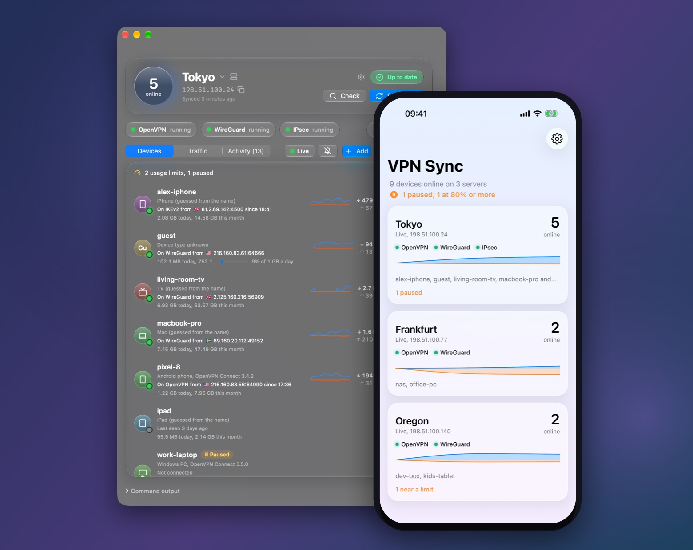
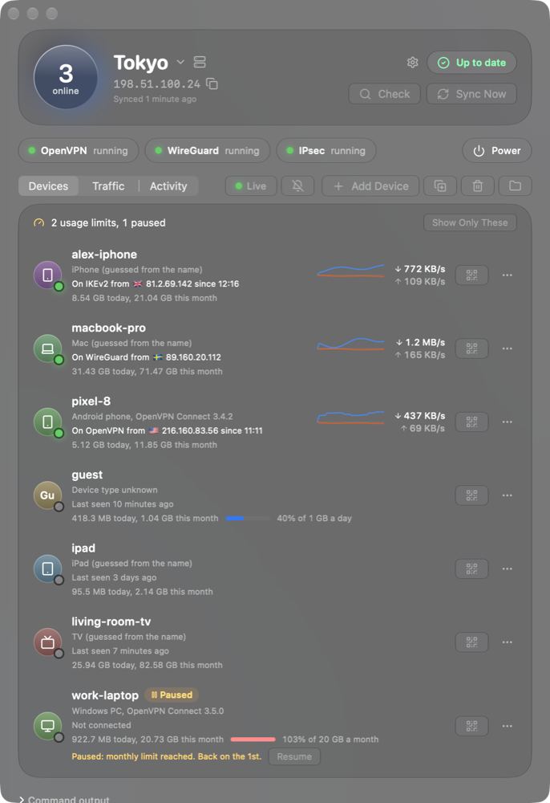
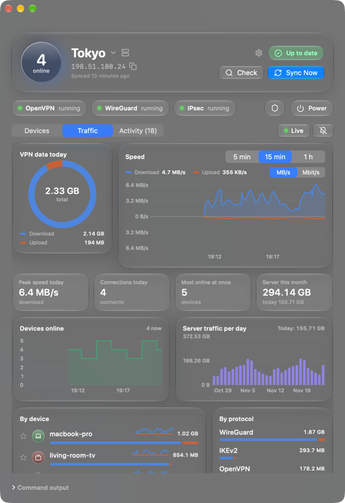
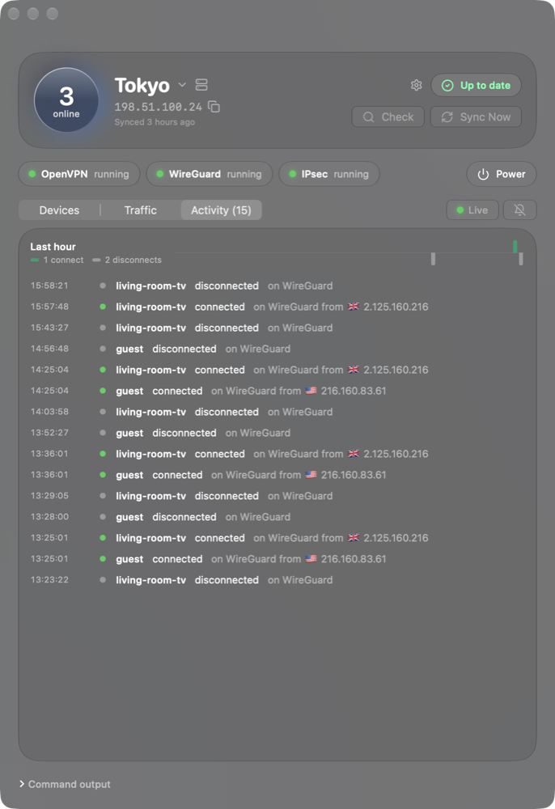
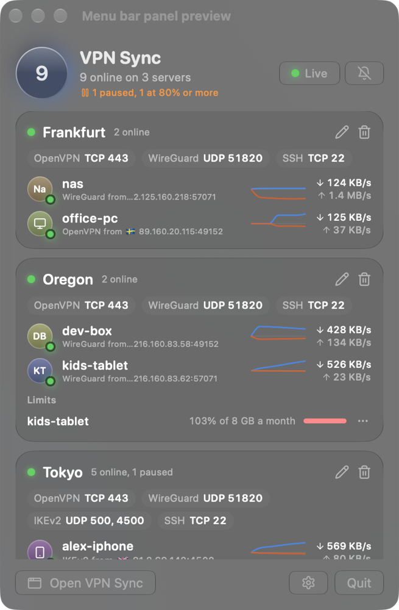
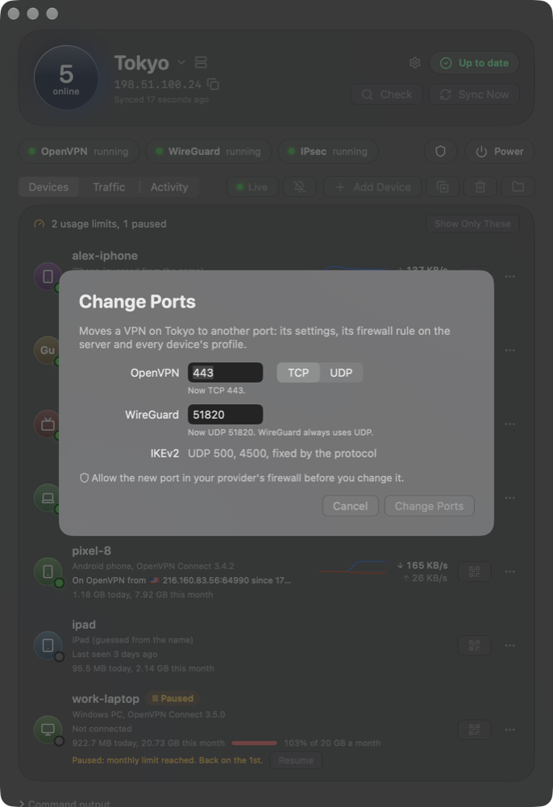
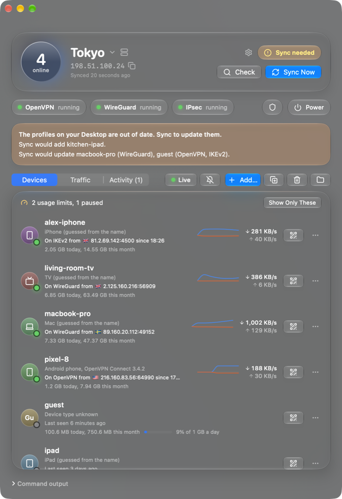
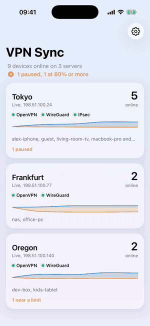
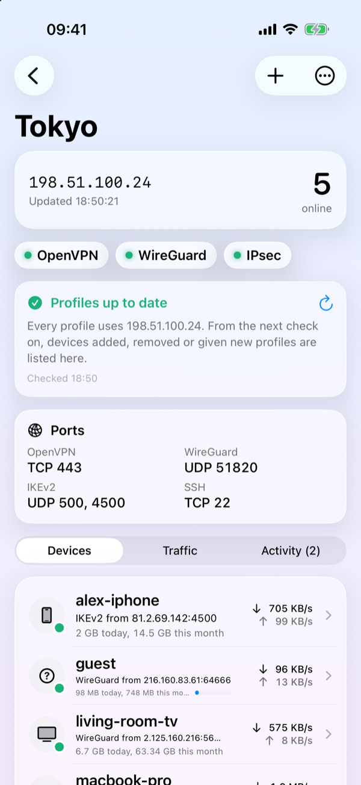
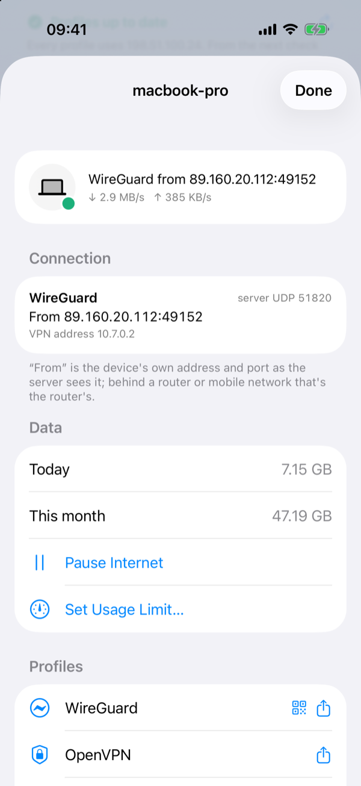

[English](README.md) | 简体中文

<p align="center">
  
</p>

<h1 align="center">VPN Sync</h1>

<p align="center">
  <b>在 Mac 和 iPhone 上查看并控制你自己的 VPN 服务器。</b><br>
  一键安装 OpenVPN、WireGuard 和 IKEv2，或接管你用脚本搭建好的服务器，<br>
  然后在一处查看谁在连接、设置限额，并管理每台设备的配置文件。
</p>

<p align="center">
  
</p>

## 为什么做这个

[Nyr 的 openvpn-install 和 wireguard-install](https://github.com/Nyr)，以及 [hwdsl2 的 setup-ipsec-vpn](https://github.com/hwdsl2/setup-ipsec-vpn) 这类一键安装脚本，几分钟就能把 VPN 跑起来。但此后脚本就成了唯一的操作界面：看不到谁在连接，也看不到每台设备用了多少流量；添加设备要通过 SSH 和文本菜单；配置文件散落各处；IP 地址一变，所有客户端都会失效；再多一台服务器，这些麻烦就翻一倍。

VPN Sync 构建在这些脚本之上。它保留你现有的安装不动，在每台服务器上添加一小组工具，并提供一个统一的入口来查看和管理所有服务器与设备。它也可以为你配置全新的服务器。

## 功能

| | |
|---|---|
| **所有服务器集中管理** | 在服务器之间切换，或在菜单栏中同时查看全部服务器。防火墙后面的服务器可通过另一台服务器，经由私有网络访问。 |
| **实时视图** | 当前谁在连接、使用哪种 VPN、来自哪个国家和端口、连接了多久、速度多快，并有连接和断开的日志，每次变化都会发送通知。 |
| **端口** | 每台服务器监听的端口（OpenVPN、WireGuard、IKEv2、SSH），以及每台已连接设备的来源地址和端口。可将 OpenVPN 或 WireGuard 迁移到其他端口：服务器、防火墙规则、所有配置文件，以及 Lightsail 上的云防火墙会一并修改。 |
| **流量** | 速度随时间变化的曲线、每台设备和每种协议的流量，以及服务器一个月内每天的流量。 |
| **用量限额** | 为每台设备设置每日或每月限额，用量达到 80% 和 100% 时提醒，也可以同时暂停该设备。还可以手动暂停或恢复任意设备的上网：设备保持连接，不会吊销任何证书或密钥。 |
| **设备与配置文件** | 在所有 VPN 上同时添加、批量添加、删除和批量删除设备。为手机和电视生成 WireGuard 二维码，生成可在 iPhone、Mac、Android 和 Windows 上原生安装的 IKEv2 配置文件。**Check**（检查）会对比服务器上的配置文件与你本地的副本，并列出同步将会新增、删除或更新的内容。 |
| **自动处理 IP 变化** | 服务器地址变化时，每台服务器会自行重写其配置文件；Mac 会拉取最新副本、修复 OpenVPN Connect，并且在配置了 Lightsail 密钥时，自动找到停止后重新启动的服务器的新 IP。 |
| **启动和停止服务器** | 在 Mac、菜单栏或 iPhone 上停止不需要的 Lightsail 服务器，并可随时重新启动；VPN Sync 会将其显示为已停止而非无法访问，启动后会自动找到新 IP 并重新同步。停止时还会在 Lightsail 防火墙中关闭它的 VPN 端口（SSH 保持开放），启动时再重新开放。 |
| **安装或接管** | 安装 OpenVPN 和/或 WireGuard（Nyr），以及可选的 IPsec/IKEv2（hwdsl2，仅 IKEv2），可自选端口和 DNS；也可以保留服务器上已有的配置。 |
| **iPhone 应用** | 无需 Mac，直接通过 SSH 在手机上管理同样的服务器：实时视图、端口、限额、设备及其配置文件、服务、停止与启动。Check Profiles（检查配置文件）会告诉你配置文件是否使用服务器当前的 IP（不是则更新），以及自上次检查以来哪些设备被添加、删除或换发了新的配置文件。 |
| **远距离也很快** | 每台服务器只保持一个共享的 SSH 连接，因此即使服务器在另一个大洲，检查、同步或用量报告也只需约一秒，实时视图则不到一秒即可启动。 |
| **命令行** | 应用能做的一切，都可通过 Mac 上的 `vpn-sync` 和每台服务器上的小工具完成。 |

## 截图

<table>
  <tr>
    <td width="50%"></td>
    <td width="50%"></td>
  </tr>
  <tr>
    <td>设备：实时连接，含国家、速度和用量；限额与暂停。</td>
    <td>流量：速度随时间变化、每台设备和每种协议的流量、服务器每天的流量。</td>
  </tr>
  <tr>
    <td></td>
    <td></td>
  </tr>
  <tr>
    <td>活动：连接、断开和限额事件。</td>
    <td>菜单栏：一眼看到每台服务器及其端口。</td>
  </tr>
  <tr>
    <td></td>
    <td></td>
  </tr>
  <tr>
    <td>更改端口：迁移 OpenVPN 或 WireGuard；配置文件和 Lightsail 防火墙随之更新。</td>
    <td>检查：同步将会新增、删除或更新的内容。</td>
  </tr>
</table>

<p align="center">
  
  &nbsp;&nbsp;
  
  &nbsp;&nbsp;
  
</p>

<sub>截图使用的是虚构的服务器和设备（`demo/`），不含真实地址。</sub>

## 安装

**Mac**（macOS 14 或更高版本；需要 Xcode 或 Command Line Tools 来构建）：

```bash
./install-mac.sh
```

这会把 `vpn-sync` 命令安装到 `~/.local/bin`（请将其加入 `PATH`），把服务器工具安装到 `~/.local/share/vpn-sync/server`，并安装 `~/Applications/VPN Sync.app`。

**iPhone**（iOS 17 或更高版本）：在 Xcode 中打开 `ios/VPNSyncPhone.xcodeproj`，在 `ios/Local.xcconfig` 中填入你的开发团队（`DEVELOPMENT_TEAM = …`，该文件不纳入 git），然后在手机上运行。使用免费 Apple ID 时，每 7 天需要重新安装一次。如需让它使用与 Mac 应用相同的图标（`app/logo.local.png`），请在 `ios/` 中运行 `swift make-local-icon.swift`，并在 `ios/Local.xcconfig` 中添加 `VPNSYNC_APP_ICON = AppIconLocal`。

**服务器：** Ubuntu、Debian、AlmaLinux、Rocky、CentOS 或 Fedora，需有 SSH 访问权限和 `sudo`。工具由 Mac 负责安装，你无需在服务器上做任何操作。

## 快速开始

1. **Add Server…**（添加服务器）：填写名称、地址、SSH 用户和密钥。核对主机密钥指纹后，点击 **Trust and Add**（信任并添加）。
2. **Set Up**（设置）：VPN Sync 会显示已安装的内容。可以保留现状，也可以选择 OpenVPN（TCP/UDP、端口）、WireGuard（端口）、DNS 和第一台设备，如需 IKEv2，请勾选 **Also install IPsec/IKEv2**。在 Lightsail 上，VPN Sync 会在其防火墙中开放端口（需要 Lightsail 密钥）；在其他服务商处，请自行在服务商的防火墙中开放。IKEv2 需要 UDP 500 和 4500。已安装的 VPN 的端口也可以在这里修改，或之后通过 **Ports → Change Ports…** 修改。
3. **Add Device**（添加设备）（或 **Batch Add…**（批量添加））。配置文件会保存到 `~/Desktop/<server>-<ip>/`；扫描 WireGuard 二维码、导入 `.ovpn`，或安装 IKEv2 的 `.mobileconfig`。
4. **iPhone**：在 Mac 上依次点击 **Settings → iPhone → Export for iPhone…**，会生成一个加密文件，并提供 AirDrop 发送。在手机上用 VPN Sync 打开它，并输入 Mac 上显示的口令。

设置（齿轮图标，或 ⌘,）中还包括通知、用量限额提醒与警告级别、外观，以及 Lightsail 密钥：有了它，VPN Sync 就能在服务器停止再启动后找到其新 IP，**Power → Stop Server / Start Server** 可以使用（服务器停止期间，它的 VPN 端口会在 Lightsail 防火墙中关闭，直到再次启动），安装或更改端口时也会在 Lightsail 防火墙中开放这些端口（它显示的策略只允许读取、停止和启动实例，以及开放或关闭其端口）。要在 iPhone 上使用这些功能，请在导出时勾选 **Include the Lightsail key**。

两个应用都支持英文和简体中文，默认跟随系统语言。如果只想为 VPN Sync 单独选择语言：在 Mac 上打开**设置 → 外观 → 语言**；在 iPhone 上打开应用内的**设置 → 语言**，它会跳转到 iOS“设置”应用中的 VPN Sync 页面。

## 命令行

```
vpn-sync [server...]                       sync profiles to the Desktop
vpn-sync --check [server]                  compare the server's profiles with the Desktop: what a
                                           sync would add, remove or update (changes nothing)
vpn-sync --add a,b,c <server>              create devices
vpn-sync --remove a,b <server>             revoke/remove devices
vpn-sync status <server>                   who is connected now
vpn-sync watch <server> [--interval N]     stream connection snapshots
vpn-sync ports [server...]                 ports each server listens on; each connected device's port
vpn-sync ports set <server> openvpn <port> [tcp|udp] | wireguard <port>
                                           move a VPN to another port (profiles, firewalls) and sync
vpn-sync ports open <server>               allow every VPN port in the Lightsail firewall
vpn-sync usage [server...]                 data per device today and this month, limit, % used
vpn-sync limits [server...]                only devices with a limit or a pause
vpn-sync limit <server> <device> --daily 2GB --monthly 50GB --action alert|pause
vpn-sync pause | resume <server> <device>  block or unblock a device's traffic
vpn-sync service <server> <openvpn|wireguard|ipsec|all> <start|stop|restart|status>
vpn-sync reboot <server>
vpn-sync server list | add | edit | rename | remove | hostkey | probe | install
vpn-sync server install <server> --ipsec   also install IPsec/IKEv2 (kept once installed)
vpn-sync aws state | stop | start <server> a Lightsail server's state; stop or start it (--wait)
```

运行 `vpn-sync --help` 查看全部命令。在服务器上，`sudo vpn-usage show` 会打印用量表，`sudo vpn-usage log` 会打印最近的暂停、恢复和限额变更记录。

## 工作原理

| 位置 | 作用 |
|---|---|
| `vpn-sync` | Mac 上的命令。按顺序查找每台服务器（`--ip`、跳板服务器、上次的 IP、配置的主机，然后是 Lightsail、VPN 隧道地址），并始终通过 SSH 连接，使用固定的主机密钥，每台服务器共享一个连接，因此命令不必每次都重新握手。 |
| `app/` | Mac 应用（SwiftUI）。调用 `vpn-sync`；每条命令都会记录到 `~/.config/vpn-sync/history.log`。 |
| `ios/` | iPhone 应用（SwiftUI）。自带基于 Apple swift-nio-ssh 的 SSH 客户端：Ed25519 密钥、固定主机密钥、跳板服务器。说明见 `docs/ios-app.md`。 |
| `shared/` | 两个应用共同编译的代码：实时流和用量模型、加密导出、演示数据。 |
| `server/install.sh` | 由 `vpn-sync server install` 运行。安装工具；若缺少 VPN 则安装 VPN（Nyr 的脚本，以及使用 `--ipsec` 时以仅 IKEv2 模式运行的 hwdsl2 脚本）；并写入 `/etc/vpn-sync.conf`。 |
| `server/bin/vpn-status` | 已连接的设备（OpenVPN 状态和日志、`wg show`、`ipsec trafficstatus`）、服务、流量总计、用量。 |
| `server/bin/vpn-usage` | 每台设备每天的流量（每分钟统计）、限额，以及通过 `VPNSYNC-BLOCK` 防火墙链（IPv4 和 IPv6）暂停设备。 |
| `server/bin/vpn-add-client`, `vpn-remove-client` | 通过操作安装脚本自带的菜单，在所有 VPN 上添加或删除设备；会先检查名称，被删除的文件保存在 `/root/vpn-sync-backups/`。 |
| `server/bin/vpn-endpoint-sync` | 在开机时以及之后每 15 分钟，按当前公网 IP 重写配置文件（IKEv2 则会生成新的服务器证书和新的配置文件）。 |
| `server/bin/vpn-export-profiles`, `vpn-service` | 将配置文件打包为 tarball（全部、单个设备或指定列表）；启动、停止、重启、重新引导服务器。 |

## 隐私与安全

- 所有通信都通过 SSH 连接到你自己的服务器，并固定每台服务器的主机密钥。没有账号，没有云服务，也没有遥测。
- 国家旗帜来自 Mac 上的离线表（ip-location-db，公共领域），不会在线查询任何地址。
- iPhone 导出文件经过加密（AES-GCM，PBKDF2 口令，仅显示一次）；在手机上，密钥保存在钥匙串中，仅限该设备读取，并由Face ID 锁定应用。
- 本地状态保存在 `~/.config/vpn-sync/`（服务器设置、密钥副本、固定的主机密钥）；这些内容都不应放入本仓库。

## 无需服务器即可试用

```bash
demo/run-mac-demo.sh
```

会用虚构的服务器和设备启动 Mac 应用（不会动你自己的设置）。iPhone 应用有同样的演示，使用启动参数 `-demo YES` 即可。

## 注意事项

- macOS 会请求一次访问桌面文件夹（配置文件所在位置）和发送通知的权限。
- 吊销 OpenVPN 证书无法撤销；应用总会先询问你。
- OpenVPN 每分钟更新一次状态文件，因此 OpenVPN 的速度每分钟更新一次；连接和断开则可通过其日志在几秒内显示出来。
- 当 WireGuard 设备最近一次握手距今不到 3 分钟时，视为已连接。
- 手机和电视无法远程更新：IP 变化后，需要重新扫描或导入它们的配置文件（IKEv2 则需安装新的配置文件）。使用静态 IP 可以避免这个问题。

## 致谢

[Nyr](https://github.com/Nyr)（OpenVPN 和 WireGuard 安装脚本），[hwdsl2](https://github.com/hwdsl2/setup-ipsec-vpn)（IPsec/IKEv2），[Libreswan](https://libreswan.org)、[swift-nio-ssh](https://github.com/apple/swift-nio-ssh)、[Lucide](https://lucide.dev) 图标（ISC），[ip-location-db](https://github.com/sapics/ip-location-db)（PDDL）。

## 许可证

MIT，见 [LICENSE](LICENSE)。它所调用的安装脚本（Nyr、hwdsl2）沿用各自的许可证。
